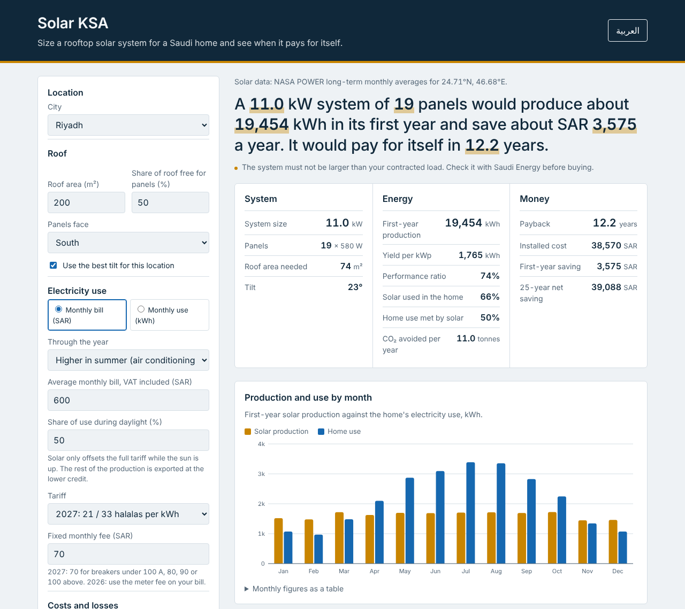

# Solar KSA

A web tool that sizes a rooftop solar system for a Saudi home and estimates when it pays for itself.

**Live:** https://mohamad-moussa.github.io/solar-ksa/



## What it does

Pick a Saudi city (or enter coordinates), enter your roof area and your monthly electricity bill or kWh. The tool returns:

- System size (kW) and number of panels that fit on the roof
- Monthly and yearly solar production
- Installed cost, first-year saving and 25-year net saving
- Payback period
- CO₂ avoided per year
- A month-by-month table and a breakdown of where energy is lost

It covers 10 cities (Riyadh, Jeddah, Dammam, Makkah, Madinah, Abha, Tabuk, Hail, Jazan, Al-Ahsa) plus custom coordinates. It works in English and Arabic, on phones, and in dark mode.

## How it works

1. **Solar data.** The browser fetches long-term monthly averages of sunlight and air temperature from the [NASA POWER](https://power.larc.nasa.gov/) API. A saved copy for the 10 cities is used if the API cannot be reached.
2. **Sunlight on the panel.** Monthly sunlight is split into direct and diffuse parts (Erbs correlation) and into hours of an average day (Collares-Pereira and Rabl). Each hour is projected onto the tilted panel using the sun's position (isotropic sky model). The tool searches tilts from 0° to 45° and picks the one with the most energy.
3. **Temperature.** Cell temperature comes from the NOCT model with a daily temperature swing from NASA. Power drops 0.30% for each degree above 25 °C.
4. **Losses.** Dust, shading, mismatch, wiring, connections, nameplate tolerance, downtime and inverter efficiency are applied (NREL PVWatts defaults, with dust raised to 5% for Saudi conditions).
5. **Roof fit.** Rows are spaced so they do not shade each other between 9:00 and 15:00 on 21 December. That spacing sets how many panels fit.
6. **Money.** Saudi Arabia uses net billing, not net metering. Solar used in the home during daylight avoids the full tariff plus VAT. Surplus sent to the grid earns 0.07 SAR/kWh. Savings are added year by year with panel degradation until they equal the installed cost.
7. **Sizing.** The tool tests every panel count that fits and recommends the one with the highest 25-year net saving. Because exports earn little, the best size is usually smaller than one that covers the whole bill.

Method reference: Duffie and Beckman, *Solar Engineering of Thermal Processes*.

## Assumptions and sources

Every figure is shown in the app with its source and date. Main values:

| Item | Value | Source |
|---|---|---|
| Residential tariff from 1 Jan 2027 | 0.21 SAR/kWh up to 6,000 kWh/month, 0.33 above | Saudi Energy announcement, Oct 2026 (as reported by Ajel and MEED) |
| Fixed monthly fee from 1 Jan 2027 | SAR 70–100 by breaker size | Saudi Energy announcement, Oct 2026 (as reported by Ajel) |
| Residential tariff until 31 Dec 2026 | 0.18 / 0.30 SAR/kWh | Saudi Energy tariff page |
| VAT | 15% | ZATCA |
| Export credit | 0.07 SAR/kWh | ECRA/SERA Small-Scale Solar PV framework, 2020 |
| Grid emission factor | 0.568 kg CO₂/kWh | Saudi CDM Designated National Authority, 2021 |
| Installed cost | SAR 3,500/kWp (editable) | Estimate within SAR 2,813–4,688/kWp from four Saudi studies |
| Panel | Jinko Tiger Neo 580 W, −0.30%/°C | Jinko datasheet (distributor copy) |
| Degradation | 1% in year one, then 0.4%/year | Jinko Tiger Neo warranty terms (pv magazine, 2021) |
| System losses, inverter | PVWatts defaults, 96% inverter | NREL PVWatts Version 5 Manual |

Assumptions with no official Saudi figure (all editable in the app): share of roof free for panels (50%), share of electricity used in daylight (50%), yearly upkeep (1% of cost), dust loss (5%).

## Verification

Results were checked against an independent hand calculation for Riyadh and Jeddah, using a different textbook method (Klein's closed-form monthly method). Inputs: 200 m² roof, SAR 600 monthly bill, 2027 tariff, south-facing.

| | Riyadh | Jeddah |
|---|---|---|
| Yearly sunlight on panel, hand vs tool | 2,404 vs 2,402 kWh/m² | 2,364 vs 2,363 kWh/m² |
| Recommended system | 19 panels, 11.0 kW | 16 panels, 9.3 kW |
| First-year production | 19,454 kWh | 16,003 kWh |
| First-year saving | SAR 3,575 | SAR 3,334 |
| Payback | 12.2 years | 10.9 years |

Hand and tool agree within 0.1%. Full working: [docs/verification.md](docs/verification.md).

The calculation engine also has 24 automated checks, including the published 2027 bill example (1,000 kWh = SAR 280 before VAT). Run them with Node.js:

```
node tests/test.js
```

## Files

| File | Purpose |
|---|---|
| `index.html` | Page structure |
| `style.css` | Layout, colours, mobile and dark mode |
| `data.js` | Cities, tariffs, defaults, sources, saved NASA data |
| `calc.js` | Solar and money calculations (no page code, so it can be tested alone) |
| `app.js` | Reads the form, fetches NASA data, draws results and charts |
| `i18n.js` | English and Arabic text |
| `tests/test.js` | Automated checks for `calc.js` |
| `docs/verification.md` | Hand calculation for Riyadh and Jeddah |

No build step and no backend: plain HTML, CSS and JavaScript on GitHub Pages.

## Limitations

- An estimate for first sizing, not a quotation. Real installers will check the roof, shading and your contracted load.
- The 2027 tariff and fee come from news reports of the Saudi Energy announcement, not the official tariff page.
- Jeddah and Makkah fall in the same NASA grid cell, so their sunlight values are the same.
- Monthly averages are used, so the self-consumption split is approximate. Households that use more power in daytime will save more.

## Author

Mohamad Moussa, Electrical Engineering graduate, King Fahd University of Petroleum and Minerals (KFUPM).
